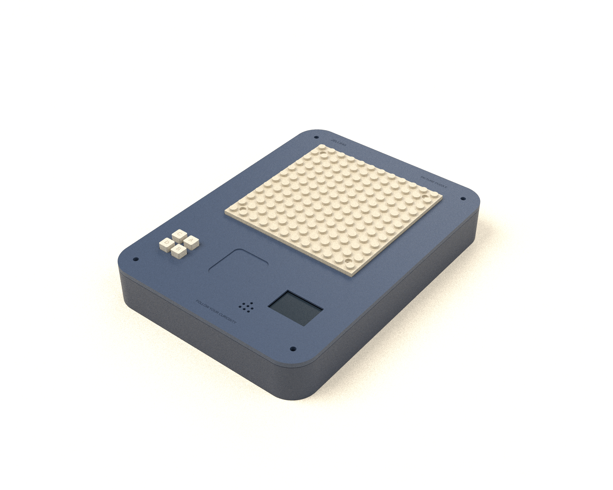
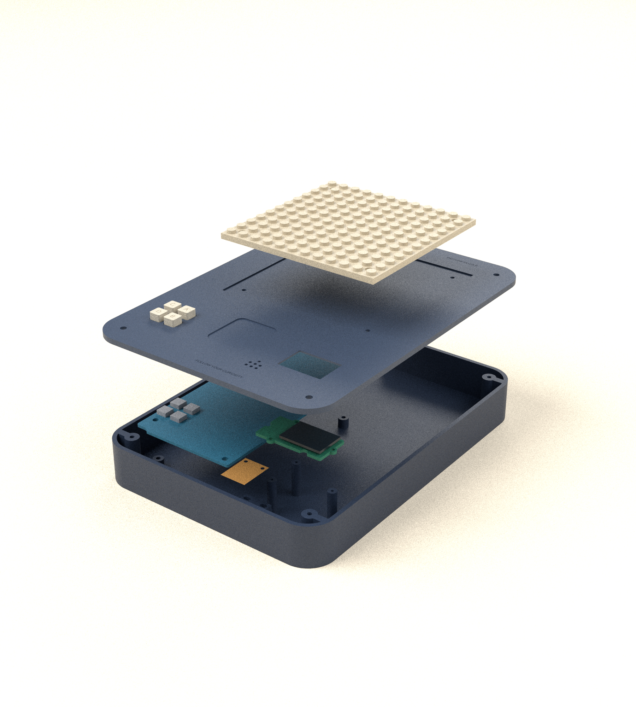
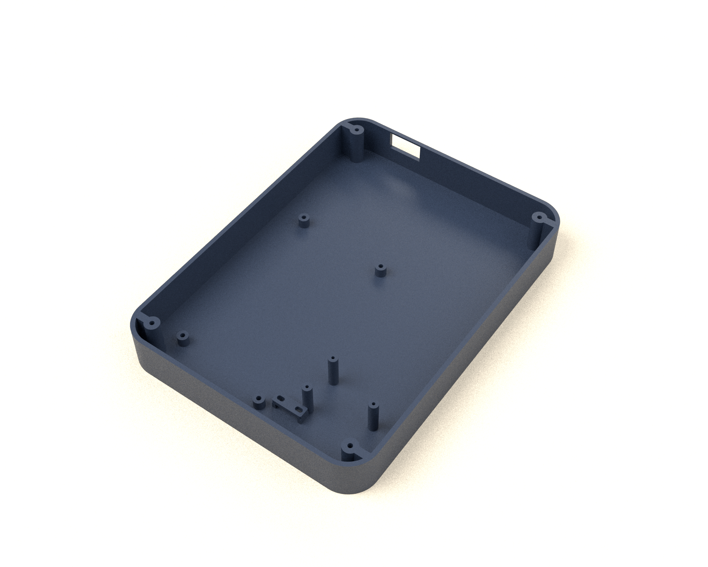

# The Jelling Journey

A tactile, screen-light museum exploration game built around a custom handheld device: follow a station beacon, tap a physical tile, answer a question on the handheld, and snap pieces onto a 12×12 stud plate to complete a picture or build a 3D brick sculpture.

---

## Why we built it

Museum visitors—especially younger ones—often spend more time looking down at a phone screen than at the exhibits around them. **The Jelling Journey** keeps eyes in the room by replacing phone apps with a dedicated physical handheld:

- **Screen-light guidance**: A tiny 0.96″ OLED and piezo buzzer guide visitors to each station via Bluetooth Low Energy (BLE) proximity—beeps and signal bars speed up as you get closer.
- **Tactile progression**: Visitors start at the entrance desk with an empty 12×12 stud plate. At each station, they tap a physical tile on the recessed NFC pad, answer an A–D exhibit question on the device, and snap the earned piece onto their plate.
- **Modular for any museum**: Curators can swap NFC cards, questions, BLE range (indoor galleries or outdoor monument trails), and even hand out 3D bricks instead of flat tiles to build a miniature sculpture.

---

## Open the web simulator & presentation (no server needed)

All web pages are self-contained and load directly in your browser by double-clicking the HTML file (or via GitHub Pages):

- **[Interactive 3D Simulator](web/dist/index.html)** — Walk the museum map, test BLE proximity, tap the 3D NFC pad, press the `A–D` CAD buttons, and snap tiles onto the 1:1 CAD handheld.
- **[Animated Story Walkthrough](web/dist/story.html)** — Auto-playing 6-step 3D walkthrough of a visitor's museum journey.
- **[Full-Screen Presentation Deck](web/dist/deck.html)** — 12-slide interactive 3D pitch deck (use `←` / `→` arrows and `F` for fullscreen).

---

## Hardware & 1:1 CAD Enclosure

| Exploded 1:1 CAD Assembly | Internal Supports & Electronics |
|---|---|
|  |  |

- **Main controller**: Nordic nRF54L15 DK (BLE proximity receiver + quiz logic + 4 tactile switches `SW2`, `SW3`, `SW5`, `SW6`)
- **Station beacons**: ESP32-C3 iBeacon transmitters advertising every 100 ms
- **Display & audio**: 0.96″ SSD1315 128×64 OLED + HW-508 piezo buzzer on a custom internal platform
- **Enclosure**: 140 × 192 mm two-part shell modeled 1:1 in CadQuery directly from manufacturer PCB geometry (`cad/jelling-handheld/`)

---

## Repository structure

- `web/` — Self-contained 3D CAD web simulator, story walkthrough, presentation deck, and controller tests (`node web/check-game.cjs`)
- `cad/` — Parametric CadQuery model (`model.py`), STEP/STL fabrication files, fit-test templates, and studio renders
- `firmware/` — Embedded prototypes for nRF54L15 & ESP32-C3 (`ibeacon-demo/`, `ssd1315-demo/`, `buzzer-test/`)
- `docs/` — [Project Documentation](docs/PROJECT_DOCUMENTATION.md), [Architecture](docs/PROJECT_ARCHITECTURE.md), and [Software Specifications](docs/SOFTWARE_SPECIFICATIONS.md)
- `sources/` — Museum reference materials and exhibition media

---

## Team

- **Alexandru Gutu** — Mechatronics Engineering
- **Franciszek Florjanczyk** — Electrical Engineering
- **Peter Andras Ban** — Software Engineering
- **Simeone Gentile** — Software Engineering
