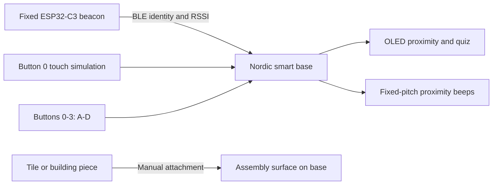

# The Jelling Journey — Project guide

**Updated 14 November 2026.** This guide describes the project concept, the
working firmware and browser prototype, setup and use, and the options for
turning the smart base into a picture puzzle or a construction activity.

The current hardware is an **ESP32-C3 station beacon and an nRF54L15 visitor
base**, with an SSD1315 OLED, passive-buzzer output and four onboard buttons.
They have been built and flashed with matching identities; live radio reception
has been observed. The real NFC reader, physical collectible system, persistent
hardware progress and staff return workflow are still future integrations.
At the last recorded hardware check the OLED was not responding, so physical
display operation and the complete visitor journey are not yet verified.

## Contents

1. [Purpose and experience](#1-purpose-and-experience)
2. [Scope and current status](#2-scope-and-current-status)
3. [System and physical objects](#3-system-and-physical-objects)
4. [Visitor and staff journeys](#4-visitor-and-staff-journeys)
5. [Hardware functionality and controls](#5-hardware-functionality-and-controls)
6. [Tiles, building blocks and other activity options](#6-tiles-building-blocks-and-other-activity-options)
7. [Hardware connections](#7-hardware-connections)
8. [Build, flash and run](#8-build-flash-and-run)
9. [Configuration and adding stations](#9-configuration-and-adding-stations)
10. [Browser simulator](#10-browser-simulator)
11. [Validation, troubleshooting and delivery](#11-validation-troubleshooting-and-delivery)
12. [Repository and related documents](#12-repository-and-related-documents)

## 1. Purpose and experience

The Jelling Journey is a hands-on museum exploration game. Visitors carry a
smart base, follow visual and audible proximity feedback to an exhibit,
interact with that station, answer a question, and earn a physical piece.
The pieces gradually complete something on the base: a picture in the original
concept, or a model made from building blocks in an alternative version.

The historical concept is the Great Jelling Stone and its copies around the
world. The interaction can be reused with other exhibitions by changing the
route, question content and physical build. Historical source material and
case documents are in `sources/`; the current questions are demonstration
content, not approved exhibition interpretation.

The base supports exploration rather than turn-by-turn navigation. Faster
beeps indicate greater estimated proximity to the current target; they do
not provide a direction or a safe route through walls. Posters, landmarks and
staff provide the route context and full exhibit explanations.

The intended complete museum experience ends at a staffed return desk. Staff
checks the kit and completed activity, records redemption, and awards a prize.
That return-for-prize flow exists in the browser demonstration and product
requirements; it is not implemented in the current Nordic firmware.

## 2. Scope and current status

### The present hardware prototype

The firmware connects the features developed during this project into one
Nordic application. The ESP is a stationary transmitter; the Nordic is carried
by the visitor. There are **two configured waypoints**, but only station 01's
ESP has been flashed and radio-verified in this session. Station 02 is a
prepared future target and will remain SEARCHING until its beacon exists.

| Capability | Hardware firmware | Browser prototype / product scope |
| --- | --- | --- |
| Specific-beacon detection | Live iBeacon matching by UUID, major and minor; radio reception verified | Synthetic beacon positions on a map |
| Distance and proximity | Smoothed RSSI estimate; SEARCHING/FAR/NEAR/CLOSE | Distance in map units; not live RF |
| Visual and audible guidance | OLED rendering and synchronized passive-buzzer scheduler implemented; latest OLED connection check failed | Simulated 128×64 OLED and optional synthesized sound |
| Touch/check-in | Button 0 simulates an NFC touch after stable CLOSE | Clicking Scan tile or the NFC pad simulates a tagged tile |
| A–D quiz | Four debounced onboard buttons, wrong-answer retry, correct-answer progression | Physical-style buttons, keyboard and clickable answers |
| Multiple waypoints | Ordered, configurable 1–9-entry route; old target readings cleared on advancement | Default two-station route; isolated 0/1/9-station fixtures |
| Physical item identity | No reader or UID binding yet | Station/tile-type simulation only |
| Physical assembly | No attachment, position or shape sensing | Illustrative 3×3 tile attachment, separate from validation |
| Saved progress | RAM only; restarting returns to station 01 | Browser localStorage with partial restored-state validation |
| Return and prize | Not implemented | Illustrative return checks and one-time redemption |
| Quiet mode | Not implemented in the current hardware app | Sound on/off control; a hardware quiet control is planned |
| Construction with blocks | Product option; no block-specific sensing or software mode yet | LEGO-style page is visual styling, not a block-building simulator |

“Implemented” means the code exists, not that every physical interaction has
been exercised. The host tests verify controller behavior; they cannot verify
antenna performance, buzzer wiring, screen appearance or visitor usability.

### Hackathon demonstration target

The intended end-to-end demonstration uses one visitor base and two powered
station beacons, with one question and one collectible reward per station.
The original collectible is a tagged picture tile. A two-stage block build is
an alternative if the team chooses that physical format.

The original 3×3 picture has nine positions. A two-station demonstration does
not need nine stations: seven positions may start filled, as they do in the
browser. The physical preloaded kit must still be decided and counted. In a
block version, start with a foundation and distribute two clearly identified
build steps rather than assuming every brick needs its own station.

Out of current prototype scope: reliable metre-level ranging; automatic 3D
construction checking; real NFC integration; persistent hardware sessions;
authenticated staff tools; prize redemption on the device; fleet management;
multiple simultaneous routes on one base; speech playback; and visitor accounts
or movement-history tracking. These are separate decisions or future work.

## 3. System and physical objects

| Object | What it contains | What it does |
| --- | --- | --- |
| Smart visitor base | nRF54L15 DK, OLED, buzzer, four buttons, power and an assembly surface | Receives the current beacon, runs the game, provides feedback and supports the visitor's physical build |
| Fixed station | ESP32-C3 beacon, its own power, exhibit/question panel and optional piece supply | Advertises station identity; supplies the learning task and collectible |
| Picture tile or building piece | A passive mechanical item; optionally an embedded NFC tag in the future | Represents the station's reward or build step; travels with the visitor |
| Staff station | Kit inventory, return area and development/service tools | Prepares kits, helps visitors, checks returns and handles prizes in the intended product |

A fixed ESP does not contain the visitor's progress or question controller.
Its only current job is advertising. The collectible has no BLE radio or
battery in the proposed NFC-based design. The Nordic is the current game
authority; several bases could independently listen to the same station beacons.
That multi-base deployment still needs a practical venue trial.



The physical attachment arrow is independent of the electronics: attaching a
piece currently sends no event to the game. A future NFC reader would identify
a piece at a scan pad; it would not, by itself, detect where that piece was
subsequently attached.

## 4. Visitor and staff journeys

### Using the currently flashed hardware

1. Power the ESP and Nordic. Connect the display correctly; the application
   waits for successful rendering before enabling beeps and button actions.
2. The base searches for station 01's specific identity. Walk with the Nordic;
   keep the ESP fixed. The OLED is designed to show the station, estimated
   metres, proximity label and segmented bar.
3. At an estimated distance of **1.5 m or less**, CLOSE becomes a candidate.
   After the stability/freshness requirements are met, `B0 TOUCH` appears.
4. Press **Button 0**, then release it. This stands in for touching an NFC tag.
   It does not read or validate any physical tile or block.
5. Answer with Button 0=A, Button 1=B, Button 2=C or Button 3=D. For station 01,
   “WHAT IS TWO / PLUS TWO?” has options 3, 4, 5, 6: **B is correct**.
6. A wrong answer shows WRONG, then returns to the same question. A correct
   answer shows CORRECT, then switches to station 02 and clears station 01's
   readings. There is no second tag touch after a correct answer.
7. Without a station 02 ESP, the base waits in SEARCHING. When that future
   beacon is added, its example question asks which option is a colour;
   **A, BLUE**, is correct. Completing the route displays ALL DONE.
8. Resetting the Nordic starts over. There is no persistent hardware progress
   or hardware return/prize state yet.

The accepted question stays active if the visitor moves away or the beacon is
lost. Navigation beeps are silent while answering, during answer feedback and
after completion. A held Button 0 touch cannot accidentally submit answer A;
a new, debounced press is required after release.

### Intended visitor experience with collectibles

Staff issues one prepared base per group and explains the route, touch point,
A–D controls, assembly surface and return requirement. At each station visitors
take the appropriate physical reward, tap its tag on the base, answer the
question and attach/build with the reward after success. Scanning must match
the current station and its fresh CLOSE gate. Wrong pieces and future-station
pieces do not unlock a question. Retries do not require another scan.

Correct answers advance navigation immediately; physical assembly is separate.
Visitors finish the picture or model and return the base and all issued parts.
Staff checks electronic completion, the physical result and returned inventory
before recording redemption and awarding a prize.

For block rewards, the team may instead hand out a small pack after the answer.
That changes the distribution workflow: specify whether a tagged representative
piece/card is scanned before answering or staff performs the reward handover.
Do not silently call an untagged pack an electronically identified collectible.

### Staff operation and recovery

Before a session, check power, all beacon identities, OLED/buzzer operation,
questions, piece stocks and the kit's starting inventory. Explain that faster
beeps indicate proximity and that the base must be held in a normal carrying
position. Use printed landmark clues where RF proximity is ambiguous.

For the current firmware, a restart is a development reset and loses progress.
For the intended product, session start, assistance, replacement pieces,
redemption and reset need controlled staff actions and durable records. A faulty
beacon should not automatically unlock check-in: repair it or use a future
explicit, recorded override for the current task. That override is not present
in the hardware today.

## 5. Hardware functionality and controls

### Beacon identity and advertising

The ESP32-C3 sends a nonconnectable legacy iBeacon advertisement on all three
advertising channels at a configured interval of **100 ms**, plus Bluetooth's
random advertising delay. This replaced the earlier 300 ms interval. It needs
no pairing, Wi-Fi connection, phone, account or cloud service.

Both boards already share these identities:

| Field | Station 01, flashed | Station 02, future |
| --- | --- | --- |
| UUID | `7b8a2f10-6c45-4d9e-a123-54726b617468` | Same UUID |
| Major / exhibition ID | 1 | 1 |
| Minor / station ID | 1 | 2 |

The observed ESP MAC is `e8:3d:c1:95:8c:1c`. It is useful for diagnostics;
current filtering uses UUID + major + minor, not the MAC. No IDs are needed
from the visitor. Another station's stronger signal cannot change the target.
There is no separate version field in the current iBeacon payload.

### Distance model and calibration

The receiver smooths RSSI with an exponential moving average, alpha **0.20**,
and estimates distance using:

```text
estimated_metres = 10 ^ ((RSSI_at_1m - filtered_RSSI) / (10 × path_loss_exponent))
```

The advertised one-metre calibration defaults to **−59 dBm**, and each route
entry starts with a path-loss exponent of **2.0**. Those are tuning defaults.
The calibration byte is expected received strength at one metre, not the ESP's
radio transmit-power setting. The displayed `EST` value is not a direct range
measurement or a promise of 1.5 m accuracy.

To calibrate, place both boards one metre apart in their final cases and normal
orientation, log 30–60 seconds of raw RSSI, and use the median as the ESP's
one-metre value. Verify at known distances such as two and four metres and tune
the station's exponent. Repeat with people nearby and with the base held as a
visitor would hold it. Final enclosure layout, hands and antenna obstruction
can change the readings.

### Proximity, feedback and touch eligibility

| Setting | Current behavior |
| --- | --- |
| SEARCHING | No usable current-target estimate, too few samples or expired signal; animated bar, silent |
| CLOSE entry | Estimated distance ≤1.5 m, subject to stability checks |
| CLOSE exit | Distance >1.8 m; the gap prevents rapid boundary switching |
| FAR / NEAR | Nominal boundary near 5 m; FAR holds down to 4.5 m, NEAR holds up to 5.5 m |
| Band transition dwell | 500 ms |
| Close eligibility dwell | A further 1000 ms in stable CLOSE |
| Sample minimum | Five received samples |
| Touch freshness | Matching packet received within the past one second |
| Lost timeout | Five seconds without the current beacon; clear band and touch eligibility |
| Beep pitch/duration | Fixed 2 kHz, 60 ms bursts |
| FAR / NEAR / CLOSE silent gap | 1000 / 400 / 100 ms |
| Answer result display | 1500 ms before retry or advancement |
| Button debounce / polling | 40 ms / approximately 20 ms |

The current bar uses two, six or ten filled segments for FAR, NEAR or CLOSE;
it is a band indicator, not ten calibrated distance steps. Faster advertising
improves opportunities to update RSSI; it does not eliminate radio noise or
calibrate the model.

All button actions require a successfully rendered current screen. The display
runs in a separate thread, and a new beep cadence starts only after its matching
screen has rendered. I2C transfers do not block button polling or tone timing.
If the OLED fails, the app retries initialization every five seconds while BLE
and serial diagnostics continue; beeps and quiz presses remain paused.

### States and input behavior

| Hardware state | Accepted action | Next behavior |
| --- | --- | --- |
| NAVIGATING | Fresh Button 0 press while stable CLOSE and display ready | QUESTION |
| QUESTION | One fresh A–D press | ANSWER_RIGHT or ANSWER_WRONG |
| ANSWER_WRONG | Wait 1.5 s; further presses ignored | Same QUESTION |
| ANSWER_RIGHT | Wait 1.5 s | Next target, or ROUTE_COMPLETE |
| ROUTE_COMPLETE | No visitor game action | ALL DONE; reset begins a new prototype run |
| CONFIG_ERROR | No visitor game action | Correct the compiled route configuration |

Held buttons and simultaneous-button chords cannot submit repeated answers.
Changing targets clears RSSI history and close readiness. An accepted question
is latched, so losing proximity afterward does not cancel it.

## 6. Tiles, building blocks and other activity options

The shared concept is **find → check in → solve → earn/build → continue**.
The reward format can change without changing beacon navigation. What must
change is the physical kit, reward metadata, visitor instructions and any
assembly-validation policy. None of these alternatives automatically adds
construction sensing to the present base.

| Format | What visitors assemble | Reuse from current work | Additional work |
| --- | --- | --- | --- |
| Picture tiles, original baseline | A flat 3×3 image | Route, quizzes, proximity; browser tile illustration | Actual tagged tiles, reader, fitted plate and inventory |
| Building blocks | A small model, monument, animal or exhibit scene on the base | Same beacon/quiz controller and stud-compatible assembly idea | Build design, piece packs, retention, instructions and reward mapping |
| Hybrid | Picture foundation plus raised blocks or a final model | Flat picture progression with a physical build stage | Combined kit design, height/visibility checks and instructions |
| Modular artefact pieces | A replica or object assembled from shaped parts | Same ordered stations and milestones | Connectors, part identity, assembly steps and durability |
| No collectible / digital-only trial | A completed route and questions | Current button-touch firmware is closest to this | Revise visitor promise; no automatic physical reward tracking |

### Building blocks on the smart base

A concrete two-station prototype could start with a fixed foundation, earn one
piece pack at station 01 and another at station 02, and finish a small model on
the base. The model should relate to the exhibition; the exact design and parts
are a team/content decision. This is a proposed version, not a built model or
implemented block mode.

Two construction styles are possible:

- **Guided construction:** every station awards the parts for a defined step.
  A printed diagram shows where they fit, and staff checks the final result.
  This makes an educational sequence and return inventory easier to explain.
- **Open construction:** each station awards parts with which the group builds
  its own interpretation. Success is completing the route and participating,
  rather than matching one exact shape. Staff checks returned parts rather
  than enforcing a hidden structural answer.

The reward/identity options also differ:

| Identification choice | What the base can know | Trade-off |
| --- | --- | --- |
| Button 0 touch, current prototype | Visitor requested check-in while eligible | No physical piece identity; easiest demonstration |
| One tagged representative piece per step | Which step's piece was presented | Cannot count all untagged pieces in its pack |
| Tagged card/token for a piece pack | Which pack was claimed/scanned | Token identity does not prove pack contents or attachment |
| Tag on every relevant block | Which individual blocks were presented | More tags, provisioning and sequential scans; still no shape/position sensing |
| Staff supplies pieces after success | Staff confirms the handover | Requires staffing; firmware reward-handover state is future work |

For a first block demonstration, a small defined pack per station with a
representative tag or card is a practical proposed option. Record a pack ID,
its station/question mapping, build-step number, parts inventory and return
check. The current `route[]` does not contain those reward fields; they would
be added with NFC/reward integration.

**Knowing a tag is not knowing a build.** A single NFC pad cannot determine a
brick's coordinates, orientation, attachment or the model's shape. Automatic
checking would need additional sensing—such as position-specific readers,
contacts, other sensors or vision—and its own engineering and testing scope.
Until then, visual/staff inspection or visitor self-checks must be explicit.

The construction platform also needs mechanical design: a stable grip and
centre of mass, attachment that survives walking, removable/reusable parts,
access to buttons and scan pad, and an unobstructed OLED. Avoid covering the
BLE antenna or introducing materials that compromise radio/tag operation.
Choose the assembly surface independently of the current browser's nine tile
slots. The firmware currently validates at most nine route entries; increasing
that limit is a software/content change, not something a larger baseplate does
automatically.

### Other configurable experience options

The following are possible product directions, with their present status:

- **More stations:** already supported through an ordered 1–9-entry firmware
  route. Each additional physical station needs a beacon, content and power.
- **Different exhibition themes or languages:** author different content.
  The browser handles long/multilingual text; the current firmware font is
  uppercase ASCII with tight field limits, so wider language support needs work.
- **Multiple routes or difficulty levels:** planned content-selection behavior;
  today each build has one compiled route, not a visitor-selectable route menu.
- **Quiet operation:** browser sound can be turned off. Hardware quiet controls
  and equivalent visual visitor guidance are a future addition.
- **Cooperative groups / multiple kits:** one group can share a base. Independent
  bases can use the same beacons conceptually, but kit IDs, inventory and venue
  capacity need operational testing. No networking between kits is implemented.
- **Hints, scoring and time challenges:** future features. Unlimited answer
  retries currently preserve progress; there is no score, timer or penalty.
- **Accessible non-audio / alternative input modes:** useful design options;
  validate them with users rather than treating the current small OLED and
  four-button arrangement as an accessibility certification.

## 7. Hardware connections

Disconnect USB/power before wiring. Use printed GPIO numbers on **PORT P1**,
not physical header positions. The documented OLED is a four-pin 128×64 I2C
SSD1315 module supporting 3.3 V; other modules may need different wiring.

| Peripheral connection | nRF54L15 DK |
| --- | --- |
| OLED VCC | VDDIO configured to **3.3 V** |
| OLED GND | GND |
| OLED SCL / SCK | **P1.11** |
| OLED SDA | **P1.12** |
| Passive HW-508 S | **1 kΩ resistor → P1.14** |
| Passive HW-508 − | GND |
| Unused middle buzzer pin | Leave disconnected, if this matches the actual passive board variant |

Both peripherals share ground. P1.14 also drives onboard LED3, which may light
while beeping. The passive-piezo wiring is not a general circuit for an active
or magnetic buzzer, speaker or unknown module; confirm the actual component
and current requirements before using it. No separate VCC is assumed for the
documented passive variant.

The OLED must not use VBUS/5 V as its documented supply. I2C pull-ups must go
to 3.3 V; if the module lacks them, add 4.7 kΩ from each I2C line to 3.3 V.
The driver tries addresses 0x3C and 0x3D. Power the ESP separately through its
documented USB input; its link to the Nordic is wireless.

| Onboard button | GPIO | Game use |
| --- | --- | --- |
| Button 0 | P1.13 | Touch simulation when close; answer A in question |
| Button 1 | P1.09 | Answer B |
| Button 2 | P1.08 | Answer C |
| Button 3 | P0.04 | Answer D |

No external button wiring is needed for the DK. The intended enclosure can
later arrange external controls A/B above C/D, with a revised pin map if needed.
A real NFC reader has not been allocated pins or a bus yet. Do not assume the
Nordic's NFC tag hardware or its debugger USB connection is an NFC reader.

## 8. Build, flash and run

Run the following from the project root. These are commands for a normal local
terminal; this workspace's agent additionally prefixes shell commands with
`rtk` as instructed in its environment.

### ESP32-C3

The hardware-tested path uses PlatformIO with Espressif32 **7.0.1**,
Arduino-ESP32 **2.0.17**, and native ESP32-C3 USB Serial/JTAG:

```sh
pio run --project-dir ibeacon-demo/esp32-c3
pio run --project-dir ibeacon-demo/esp32-c3 --target upload --upload-port /dev/cu.usbmodem21301
```

Change the port for the connected ESP. The identified board was an ESP32-C3
with 4 MB flash. The C beacon implementation is shared with the alternative
ESP-IDF entry point; the small Arduino wrapper starts it and preserves BLE
memory during startup. PlatformIO is the path built/flashed in this session;
the standalone ESP-IDF 5.4.x option is documented in the firmware README but
has not been built here.

### nRF54L15 DK

In an activated **nRF Connect SDK v3.4.2** terminal:

```sh
west build -p always --no-sysbuild -b nrf54l15dk/nrf54l15/cpuapp -d ibeacon-demo/nrf54l15/build/direct ibeacon-demo/nrf54l15
west flash -d ibeacon-demo/nrf54l15/build/direct
```

Select the intended DK if several are connected. The programmed DK serial is
`1057717095`. Open its VCOM 1 at **115200 baud**; the observed macOS port was
`/dev/cu.usbmodem0010577170953`. Ports can change after reconnecting.
The nRF Connect VS Code extension is an alternative build/flash interface.

In this restricted development environment, Zephyr/ccache were placed in
writable temporary paths using `-DUSER_CACHE_DIR=/tmp/techathon-zephyr-cache`
and `CCACHE_DIR=/tmp/techathon-ccache`. These are build-cache settings, not
visitor-facing features.

Expected startup includes the selected target and live game status. A serial
line with `fresh=1` shows recent matching packets; the state/band values are
diagnostics, not evidence that a physical OLED is lit. If the OLED is absent,
logs report the failed addresses and repeat the initialization attempt.

## 9. Configuration and adding stations

| File | Configure here |
| --- | --- |
| `ibeacon-demo/common/beacon.h` | Shared UUID/major defaults, payload layout and one-metre calibration |
| `ibeacon-demo/esp32-c3/main/station_config.h` | That ESP's minor/station number |
| `ibeacon-demo/esp32-c3/main/main.c` | Advertising interval and transmitter startup |
| `ibeacon-demo/nrf54l15/src/route.c` | Ordered beacon identities, station labels, questions, answers and per-station exponent |
| `ibeacon-demo/nrf54l15/src/game.c` | Proximity thresholds, dwell, result timing and beep gaps |
| `ibeacon-demo/common/proximity.h` | RSSI smoothing and lost timeout |
| `ibeacon-demo/nrf54l15/src/main.c` | Button polling, live reception, tone scheduling and display coordination |
| `ibeacon-demo/nrf54l15/src/oled.c` | Font and screen layout |
| `ibeacon-demo/nrf54l15/app.overlay` | OLED/buzzer pin configuration |

To add a station, add a route entry, give it a unique full beacon identity,
set its question/answers and answer key, and flash its ESP with the matching
UUID/major/minor. Rebuild and flash the Nordic with the complete ordered route.
For a temporary one-station trial, remove the second route entry; the last
correct answer will then complete the route rather than wait for station 02.

The current route validator accepts **1–9 entries**. It rejects duplicate full
beacon identities, invalid answer keys, missing/oversized text, unsupported
characters and invalid path-loss exponents. The answer key is 0=A, 1=B, 2=C,
3=D. Labels are limited to 14 characters, each of two question lines to 20,
and each answer to 8. Use uppercase A–Z, digits, spaces, question marks,
hyphens and periods. These limits belong to the small hardware font and layout,
not to the browser's wrapping text.

The current route has no tile UID, block-pack, image-position or persistent
session fields. Add those deliberately when implementing real rewards/NFC;
a correct quiz result today records a route milestone in RAM, not a physical
item transaction.

## 10. Browser simulator

Serve the static files from the project root:

```sh
python3 -m http.server 4173 --directory jelling-emulator/dist
```

Open the museum page at [localhost:4173](http://127.0.0.1:4173/), the
[LEGO-style page](http://127.0.0.1:4173/lego.html), or the isolated
[UI lab](http://127.0.0.1:4173/ui-lab.html?data=demo).

Move the player by clicking/dragging the map, using focused-map arrow keys,
or the labelled direction buttons. Enter the current station's highlighted
circle, scan its tile, answer A–D, attach the validated tile, and move to the
next station. Sound is optional and initially off. After completing both
stations, begin the staff return check, tick inventory and picture checks,
and record redemption. Restart requires confirmation.

The map's CLOSE boundary is **30 map units**, not 1.5 metres. It models neither
RSSI noise nor packet freshness/hysteresis/dwell. It does not connect to the
flashed boards. The browser's first answer is **B**, and its second is **C**;
these museum-themed demonstration questions differ from the firmware's short
hardware-test questions.

The plate has nine image positions, seven preloaded and two collectible.
Validation and attachment are distinct actions. Advancing targets leaves the
player's position unchanged. Wrong/future-station tiles are rejected. Answering
and return checks save locally; both page styles share the same browser-origin
session. Test datasets have separate storage keys. Storage validation is
partial and is not equivalent to reliable device persistence or staff authority.

The UI lab includes demo, worst-case text, empty, one-station and nine-station
fixtures plus 200% text. Existing UX work covers responsive surrounding layout,
44 px map controls, keyboard focus, literal-text escaping and persistent return
checkboxes. The rendered navy handheld stays **400 px wide**; this is a browser
model dimension, not a physical enclosure measurement.

`lego.html` applies LEGO-inspired styling around that same handheld and logic.
It does not replace tiles with 3D blocks or prove any physical construction
option. Browser fonts may use external resources with fallbacks; no first-load
PWA/offline-cache guarantee is implemented. The firmware's core game itself
requires no network.

## 11. Validation, troubleshooting and delivery

### Recorded evidence

| Area | Evidence recorded during this work | Still to verify |
| --- | --- | --- |
| ESP32-C3 firmware | Built/flashed, programming hash verified; advertising increased to 100 ms | Venue power/runtime and mounting behavior |
| Nordic combined game | Built/flashed/read-back verified; CLOSE changed to ≤1.5 m and re-flashed | Full real-board quiz/second-station journey |
| Radio link | Current-target live packets, `fresh=1`, approximately −41 to −44 dBm observed | Calibration, thresholds in cases, crowds and multiple beacons |
| Controller | Host sanitizer tests for protocol, matching, route validation, gating, retries, progression and buttons | Real physical button/feedback behavior with a working OLED |
| OLED code | Eight screens rendered through the actual C driver with mock I2C and visually checked; earlier HELLO demo logged I2C success | Latest combined-app check had no response at 0x3C/0x3D; panel operation remains unresolved |
| Browser | Existing controller checks and recorded UX evidence | Full malformed-route/storage validation and additional deployment trials |
| NFC, construction and staff lifecycle | Requirements and browser substitutes | Actual reader, piece identity, physical kit, persistence and staff controls |

The close-range RSSI estimates observed on the bench are uncalibrated; they do
not establish the boards' physical separation. Prior successful OLED-demo logs
do not override the newer combined-app connection failure.

Run existing checks from the project root:

```sh
node jelling-emulator/check-game.cjs
cc -std=c11 -Wall -Wextra -Werror -fsanitize=address,undefined \
  -I ibeacon-demo/common ibeacon-demo/tests/test_beacon.c -lm \
  -o /tmp/techathon-beacon-test
/tmp/techathon-beacon-test
cc -std=c11 -Wall -Wextra -Werror -fsanitize=address,undefined \
  -I ibeacon-demo/common -I ibeacon-demo/nrf54l15/src \
  ibeacon-demo/tests/test_game.c ibeacon-demo/nrf54l15/src/game.c \
  ibeacon-demo/nrf54l15/src/route.c -lm -o /tmp/techathon-game-test
/tmp/techathon-game-test
```

The separate buzzer/OLED simulation and HELLO applications help isolate wiring.
Flashing either replaces the running game on the Nordic; it is not a background
mode of the combined firmware. Earlier fixed-beep and pitch-sweep experiments
were development steps. The current navigation changes beep spacing at a fixed
pitch; it does not sweep the tone frequency.

### Troubleshooting

| Symptom | Check/action |
| --- | --- |
| SEARCHING indefinitely | Power the current target ESP; match UUID/major/minor; ensure it is advertising; inspect serial reception |
| SEARCHING after first correct answer | Expected when station 02 does not yet exist; add its ESP or configure a one-station route |
| Distance changes while stationary | Expected RSSI variation; calibrate with final mounting and use bands rather than treating EST as precision ranging |
| Near the ESP but touch unavailable | Wait for samples, band dwell, close dwell, recent packets and a successfully rendered screen |
| No screen, no beep, buttons ignored | Check OLED VCC/GND/SCL/SDA, 3.3 V and address response; the app intentionally waits for display success |
| Beeps stop after touch | Expected in the question and result states |
| Held Button 0 does not answer A | Expected release gate; release fully and press again |
| Wrong answer does not advance | Expected retry behavior; answer B for firmware station 01, A for station 02 |
| Restart loses progress | Current hardware is RAM-only; persistent sessions are future work |
| A tile/block is attached but nothing changes | Placement is not sensed; game progress comes from check-in and correct answers |
| Another nearby ESP has no effect | Expected current-target filtering |

### Delivery priorities

1. Restore OLED communication and verify real screen/buzzer/button behavior.
2. Calibrate radio proximity and test the complete first-station touch/quiz flow.
3. Add the second ESP and run the ordered two-station journey, including signal
   loss and the old beacon remaining nearby after advancement.
4. Choose the physical activity: picture tiles, a defined block build or a hybrid;
   finalize the starting kit, reward packs, assembly surface and printed content.
5. Integrate a real NFC reader and item/pack mapping. Preserve the current-target
   proximity gate, retries and release-armed answer behavior.
6. Add durable sessions, controlled staff assistance/reset/return/redemption,
   physical inventory procedures and any required quiet/accessibility controls.
7. Run a visitor trial without developer explanation, including assembly while
   walking, station stock, power/runtime and the complete return process.

Open decisions include audience age/group size, final question content, reader
model/interface, actual buzzer ratings, physical dimensions and connectors,
reward format, preload inventory, final station count, venue calibration,
accessibility needs, prize policy and staff operating procedures.

## 12. Repository and related documents

| Location | Purpose |
| --- | --- |
| [README.md](README.md) | Entry point and quick links |
| [PROJECT_ARCHITECTURE.md](PROJECT_ARCHITECTURE.md) | Integrated product architecture and intended museum operating rules |
| [SOFTWARE_SPECIFICATIONS.md](SOFTWARE_SPECIFICATIONS.md) | Shared requirements, browser contract and remaining software gaps |
| [ibeacon-demo/README.md](ibeacon-demo/README.md) | Detailed combined firmware configuration, wiring and build guide |
| [jelling-emulator/README.md](jelling-emulator/README.md) | Browser usage and variants |
| [jelling-emulator/UX_REVIEW.md](jelling-emulator/UX_REVIEW.md) | UX findings, stress cases and prior browser evidence |
| [buzzer-test/README.md](buzzer-test/README.md) | Standalone simulated proximity screen and beep-cadence test |
| [ssd1315-demo/README.md](ssd1315-demo/README.md) | Standalone OLED HELLO test and wiring history |
| [OLED screen previews](ibeacon-demo/docs/oled-screens.png) | Software-rendered screens; not photographs of hardware |
| `sources/` | Exhibition case, location material, photographs and background documents |
| `.pitch-build/` | Working presentation/media extraction assets; not runtime game code |

This documentation update changes no firmware behavior and flashes no boards.
Product options are proposals unless explicitly identified as implemented;
recorded hardware evidence is kept separate from simulator behavior and plans.
